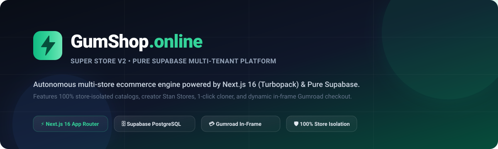
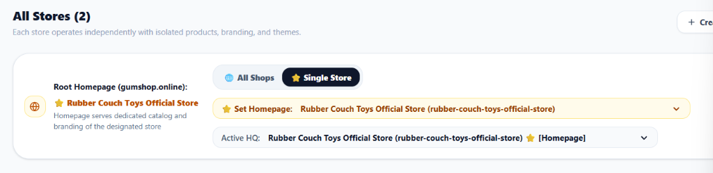
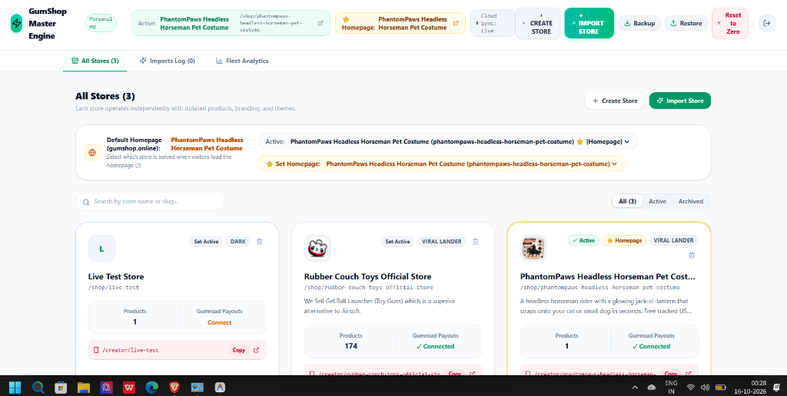
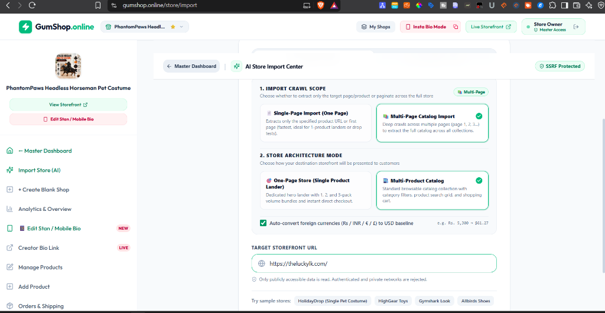
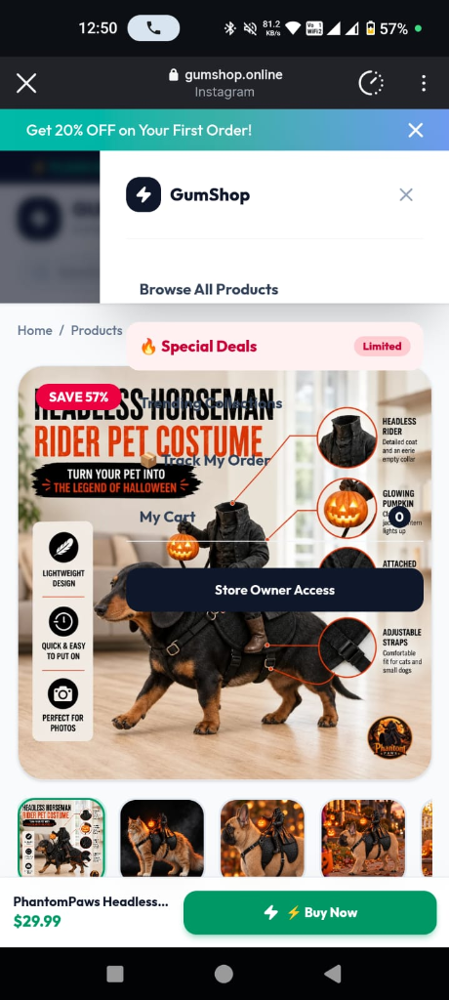
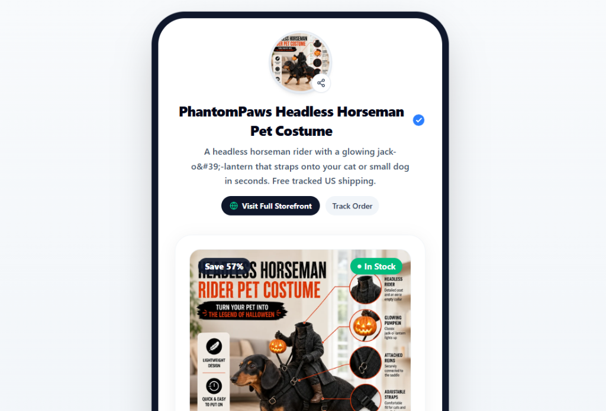
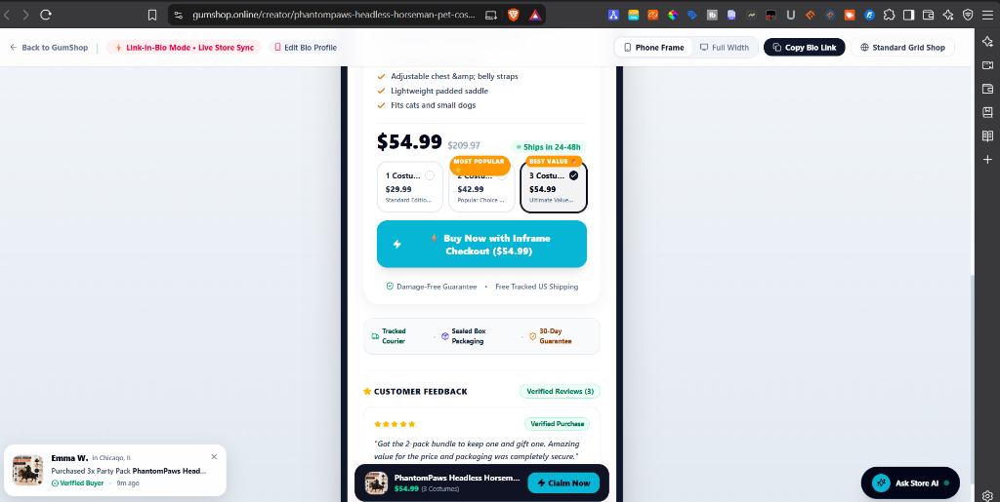
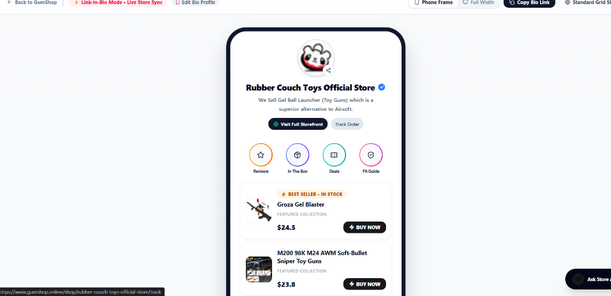
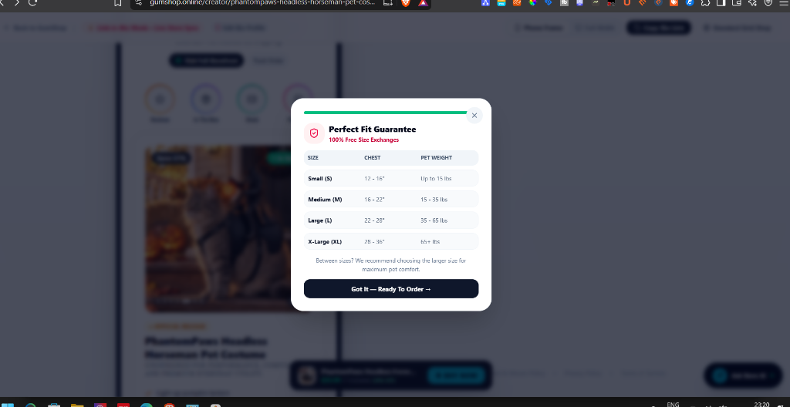

<div align="center">
  

  <br/><br/>

  [-black?style=flat&logo=next.js)](https://nextjs.org/)
  [](https://supabase.com/)
  [](https://www.gumshop.online)
  []()
  []()
</div>

---

## 🌐 Live Production Storefront & Dashboards

| Destination | Live URL | Description |
|---|---|---|
| **Production Root Storefront** | [https://www.gumshop.online](https://www.gumshop.online) | Primary homepage serving marketplace deals or designated creator store |
| **Master Fleet Command Center** | [https://www.gumshop.online/dashboard](https://www.gumshop.online/dashboard) | Central hub to manage stores, homepage switching, and fleet imports |
| **Rubber Couch Toys Official Store** | [Catalog](https://www.gumshop.online/shop/rubber-couch-toys-official-store) • [Stan Store](https://www.gumshop.online/creator/rubber-couch-toys-official-store) | 100+ gel blaster products, volume bundles, and instant checkout |
| **PhantomPaws Pet Costume** | [Catalog](https://www.gumshop.online/shop/phantompaws-headless-horseman-pet-costume) • [Stan Store](https://www.gumshop.online/creator/phantompaws-headless-horseman-pet-costume) | Viral TikTok costume with Jack-o'-lantern light and size guarantee |

---

## 📸 Platform Highlights & Visual Showcase

### 1. Master Fleet Command Center (`/dashboard`)
*Manage multiple independent stores, toggle homepage modes, monitor global imports, and configure store-level credentials with strict isolation.*

<table>
  <tr>
    <td width="50%">
      <b>Quick Store Switcher & Homepage Controller</b><br/>
      <i>Designate root homepage, toggle marketplace mode, or switch store scope.</i><br/><br/>
      
    </td>
    <td width="50%">
      <b>Fleet Store Management Cards</b><br/>
      <i>Monitor real-time product counts, theme palettes, and Gumroad payouts.</i><br/><br/>
      
    </td>
  </tr>
</table>

---

### 2. AI Store Import Center (`/store/import`)
*1-click clone external stores (Shopify, Stan Store, custom sites) with intelligent crawl scopes and SSRF protection.*

<div align="center">
  
</div>

---

### 3. High-Converting Creator Stan Store (`/creator/[username]`)
*Creator-first link-in-bio storefronts with interactive highlight reels, volume bundles, and zero-friction purchase flows.*

<table>
  <tr>
    <td width="33%" align="center">
      <b>Creator Bio & Highlights</b><br/><br/>
      
    </td>
    <td width="33%" align="center">
      <b>Mobile-Optimized Lander</b><br/><br/>
      
    </td>
    <td width="33%" align="center">
      <b>In-Frame Modal Checkout</b><br/><br/>
      
    </td>
  </tr>
</table>

---

### 4. Volume Pricing Tiers & Conversion Optimization
*Guaranteed zero price discrepancy ($52.99 baseline with 1-pack, 2-pack, and 3-pack volume discounts).*

<table>
  <tr>
    <td width="50%">
      <b>Synchronized Volume Bundles</b><br/>
      <i>Dynamic savings badges, unit price calculations, and promo codes.</i><br/><br/>
      
    </td>
    <td width="50%">
      <b>Perfect Fit Sizing Guarantee</b><br/>
      <i>Interactive sizing guide modal with trust badges and customer reviews.</i><br/><br/>
      
    </td>
  </tr>
</table>

---

## 🚀 Key Architectural Features

### 🏪 1. Multi-Store Fleet Isolation
- **100% Data Decoupling**: Each store operates with its own isolated product catalog, categories, pricing, custom branding, theme palettes, and orders.
- **Per-Store Gumroad Credentials**: Store A and Store B can maintain completely independent Gumroad API tokens and payment configurations.
- **Tombstone Protection**: Production stores (`rubber-couch-toys-official-store` and `phantompaws-headless-horseman-pet-costume`) are safeguarded against accidental client-side suppression.

### 🌐 2. Dynamic Homepage Controller
- **All Shops Marketplace Mode**: Aggregates all active stores on the root homepage (`/`), clearly displaying each product's store attribution with direct links to that shop.
- **Single Store Mode**: Pins a single designated store to the root homepage (`/`).
- **Custom Multi-Store Selection**: Choose one or multiple specific stores to feature on the root storefront.

### 💳 3. Gumroad In-Frame Dynamic Checkout
- **Instant Overlay Checkout**: Customers complete transactions without leaving your domain via `<GumroadIframeModal />`.
- **Dynamic Price Verification**: `/api/gumroad/dynamic-checkout` authoritatively validates single items and volume discount bundles (1-pack, 2-pack, 3-pack) directly against the database floor.
- **Zero Phantom Products**: Eliminates stale cached products with real-time Supabase PostgreSQL verification.

### 🔄 4. 1-Click Store Cloner & Importer
- **Automated Catalog Extraction**: Clone any external Shopify or web storefront via `/store/import` or `/store/cloner`.
- **Intelligent Media Resolution**: Preserves high-resolution CDN images, variants, descriptions, and feature bullet points.

### ⚡ 5. Pure Supabase Single Source of Truth
- **Authoritative Database**: Direct PostgreSQL queries eliminate localStorage desynchronization issues ($69 vs $29 bugs).
- **Edge Middleware Routing**: Subdomain routing (`rcdrift.gumshop.online` -> `/shop/rcdrift`) and apex redirect handling.

---

## 🛠️ Tech Stack & Dependencies

| Layer | Technologies |
|---|---|
| **Framework** | Next.js 16.4.0 (App Router, Turbopack) |
| **Language** | Modern JavaScript (ES Modules, Strict Mode) |
| **Database** | Pure Supabase PostgreSQL (PostgREST REST API) |
| **State Management** | Redux Toolkit (`@reduxjs/toolkit`), React Redux |
| **Styling & UI** | Tailwind CSS v4, Lucide React Icons |
| **Notifications** | React Hot Toast |
| **Payments** | Gumroad In-Frame Modal (`gumroad.js` lazy-loaded) |
| **Hosting & CI/CD** | Vercel (Automated zero-downtime Git deployments) |

---

## 📁 Repository Directory Structure

```text
gumshop-v2/
├── app/
│   ├── (public)/              # Public customer-facing storefront routes
│   │   ├── page.jsx           # Dynamic Root Homepage (/ - All Shops or Single Store)
│   │   ├── creator/           # Creator Stan Store (/creator/[username])
│   │   ├── shop/              # Dedicated Storefront Catalog (/shop/[username])
│   │   ├── product/           # Product Detail Page (/product/[productId])
│   │   ├── cart/              # Full Cart Page
│   │   └── track/             # Live Order Tracking
│   ├── api/                   # Serverless Backend Endpoints
│   │   ├── admin/             # Master password authentication
│   │   ├── gumroad/           # Dynamic checkout, webhooks & verification
│   │   ├── products/          # Authoritative product CRUD & marketplace aggregation
│   │   ├── store/             # Store configuration, homepage switcher, duplicate
│   │   ├── stores/            # Lightweight active stores list
│   │   └── cloner/            # External store import & clone APIs
│   └── dashboard/             # Master Fleet Command Center (/dashboard)
├── components/                # Modular React UI Components
│   ├── ProductCard.jsx        # Responsive product card with shop badges
│   ├── CartDrawer.jsx         # Sliding cart drawer with composite variant keys
│   ├── GumroadIframeModal.jsx # In-frame Gumroad checkout modal
│   └── store/                 # Store-level admin navigation and controls
├── lib/                       # Core Architecture & Database Adapters
│   ├── db/                    # Pure Supabase PostgreSQL client (Authoritative)
│   ├── activeStore.js         # Client-side store context & persistence helpers
│   ├── serverDb.js            # Unified server database interface
│   └── firebaseDb.js          # Adapter delegating directly to Supabase
├── docs/images/               # High-resolution screenshots, banners & previews
├── scripts/                   # Automated verification test suites
└── next.config.mjs            # Next.js configuration with CORS & compression
```

---

## 🧪 Automated Verification Test Suites

Every feature and payment pipeline is verified by executable test suites:

```bash
# 1. Verify 2 Stores Dashboard Resilience & Deletion Protection
node scripts/test_two_stores_resilience.js

# 2. Verify All Shops Marketplace Mode & Homepage Attribution
node scripts/test_marketplace_homepage.js

# 3. Verify Multi-Store Isolation & Checkout Integrity
node scripts/test_store_isolation_payments.js

# 4. Verify Pricing Persistence & Bundle Calculations
node scripts/test_price_persistence.js
```

---

## 💻 Local Development Setup

### 1. Prerequisites
- **Node.js**: `v18.18+` or `v20+`
- **npm** or **pnpm**

### 2. Installation
```bash
git clone https://github.com/memanmeetraj001-ctrl/gumshop.git
cd gumshop
npm install
```

### 3. Environment Configuration
Create a `.env.local` file in the project root:

```env
NEXT_PUBLIC_SUPABASE_URL=https://<your-project>.supabase.co
NEXT_PUBLIC_SUPABASE_ANON_KEY=<your-anon-key>
SUPABASE_SERVICE_ROLE_KEY=<your-service-role-key>
ADMIN_PASSWORD=<your-master-admin-password>
NEXT_PUBLIC_APP_URL=http://localhost:3000
```

### 4. Running the Development Server
```bash
npm run dev
# Server running at http://localhost:3000
```

### 5. Production Build
```bash
npm run build
npm run start
```

---

## 🚀 Continuous Deployment

The repository uses automated GitHub Actions / Vercel integration:
- Pushes to `main` automatically deploy to the live production environment at [https://www.gumshop.online](https://www.gumshop.online).
- Synced automatically with the `v2-pure-supabase` branch for version consistency.

---

## 📄 License & Attribution

Proprietary software. Developed and maintained for **GumShop Super Store**. All rights reserved.
